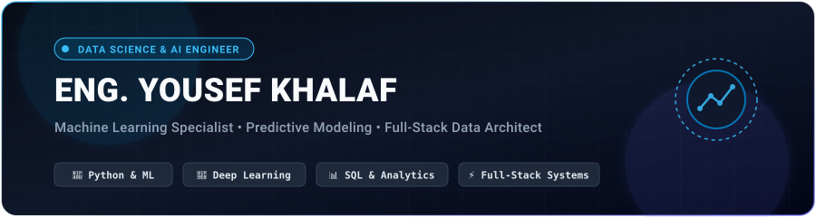

<!-- =========================================================
     Eng. Yousef Khalaf — Professional GitHub Profile README
     Keep the assets/profile-header.svg file inside the repo.
========================================================== -->

  

  
  
  
  

  

---

## Professional Profile

<table width="100%">
  <tr>
    <td width="62%" valign="top">
      <h3>Data science & engineering with an impact-first mindset</h3>
      

        I am a <strong>Data Scientist & AI / Machine Learning Engineer</strong> specializing in turning complex, 
        multidimensional datasets into predictive intelligence, statistical insights, and production-ready software solutions.
      

      

        My methodology bridges the gap between <strong>mathematical data modeling</strong> and <strong>scalable software engineering</strong>. 
        I don't just build isolated models; I architect the entire lifecycle: exploratory data analysis, robust feature engineering, 
        pipeline automation, and deploying intelligent backends that power real-world business applications.
      

      

        Alongside data science, I design and develop modern, data-driven web platforms using <strong>React</strong>, 
        <strong>Node.js/Express</strong>, <strong>Prisma ORM</strong>, and <strong>PostgreSQL</strong>.
      

    </td>
    <td width="38%" valign="top">
      <h3>Quick Snapshot</h3>
      
🔹 <strong>Primary:</strong> Data Science & Machine Learning

      
🔹 <strong>ML & AI:</strong> Python, Scikit-Learn, PyTorch, TensorFlow

      
🔹 <strong>Analytics & BI:</strong> SQL, Pandas, NumPy, Power BI, Tableau

      
🔹 <strong>Full-Stack:</strong> React 19, Node.js, Express, Prisma ORM

      
🔹 <strong>Databases:</strong> PostgreSQL, MySQL, SQLite

      
🔹 <strong>Focus:</strong> Predictive Modeling & Scalable Data Platforms

    </td>
  </tr>
</table>

---

## Core Engineering & Data Focus

<table width="100%">
  <tr>
    <td width="50%" valign="top">
      <h3>🧠 Machine Learning & Predictive Modeling</h3>
      
Supervised and unsupervised learning, classification, regression, time-series forecasting, hyperparameter tuning, and robust model validation.

    </td>
    <td width="50%" valign="top">
      <h3>📊 Data Analytics & Business Intelligence</h3>
      
Exploratory Data Analysis (EDA), statistical hypothesis testing, cohort metrics, and interactive dashboards using Power BI, Tableau, and Plotly.

    </td>
  </tr>
  <tr>
    <td width="50%" valign="top">
      <h3>⚙️ Data Pipelines & ETL Engineering</h3>
      
Automated data ingestion, cleaning, multi-source validation, spreadsheet processing engines, and transactional database integrity.

    </td>
    <td width="50%" valign="top">
      <h3>🚀 Scalable Full-Stack Data Applications</h3>
      
Architecting end-to-end web applications with modern REST APIs, role-based access control (RBAC), and responsive data visualization interfaces.

    </td>
  </tr>
</table>

---

## Technology Stack & Tooling

  

<table width="100%">
  <tr>
    <td width="25%" valign="top">
      <strong>Data Science & AI</strong> 
      • Python & R 
      • Pandas & NumPy 
      • Scikit-Learn 
      • PyTorch & TensorFlow 
      • OpenCV & NLP 
      • Jupyter & Google Colab
    </td>
    <td width="25%" valign="top">
      <strong>Analytics & BI</strong> 
      • Advanced SQL 
      • Power BI & DAX 
      • Tableau Desktop 
      • Matplotlib & Seaborn 
      • Plotly Dash 
      • Advanced Excel
    </td>
    <td width="25%" valign="top">
      <strong>Full-Stack Systems</strong> 
      • React 19 & Vite 
      • Node.js & Express 
      • Prisma ORM 
      • RESTful APIs 
      • JWT & RBAC Security 
      • JavaScript / TypeScript
    </td>
    <td width="25%" valign="top">
      <strong>DevOps & Workflow</strong> 
      • Docker Containers 
      • Git & GitHub Actions 
      • Linux Environments 
      • Cloud Deploy & Web Hosting 
      • Postman API Testing 
      • CI/CD Pipelines
    </td>
  </tr>
</table>

---

## Featured Projects & Solutions

<table width="100%">
  <thead>
    <tr>
      <th width="35%">Project</th>
      <th width="45%">Description</th>
      <th width="20%">Tech Stack</th>
    </tr>
  </thead>
  <tbody>
    <tr>
      <td>
        <strong>🏫 <a href="https://github.com/Eng-yousef-khalaf/school-management-system">Smart School Management & SIS</a></strong>
      </td>
      <td>
        Enterprise-grade academic management system featuring multi-academic-year rollover, attendance tracking, grades matrix, bilingual UI (Arabic RTL & English LTR), and Excel batch data pipelines.
      </td>
      <td>
        <code>React 19</code> <code>Node.js</code> <code>Prisma</code> <code>PostgreSQL</code>
      </td>
    </tr>
    <tr>
      <td>
        <strong>📈 Predictive Machine Learning Pipeline</strong>
      </td>
      <td>
        End-to-end ML workflows featuring data cleaning, feature engineering, classification algorithms, performance evaluation metrics, and model deployment via REST endpoints.
      </td>
      <td>
        <code>Python</code> <code>Scikit-Learn</code> <code>Pandas</code> <code>Seaborn</code>
      </td>
    </tr>
    <tr>
      <td>
        <strong>📊 Executive Business Intelligence Hub</strong>
      </td>
      <td>
        Interactive KPI dashboards delivering deep operational analytics, demographic distributions, performance tracking, and automated report generation.
      </td>
      <td>
        <code>Power BI</code> <code>SQL</code> <code>Plotly</code> <code>Excel</code>
      </td>
    </tr>
  </tbody>
</table>

---

## GitHub Stats & Activity

<table border="0">
  <tr>
    <td width="50%" align="center">
      
    </td>
    <td width="50%" align="center">
      
    </td>
  </tr>
</table>

  

---

### Let's Connect & Collaborate!

  
  
  

*⚡ "Without data, you're just another person with an opinion." — W. Edwards Deming*

