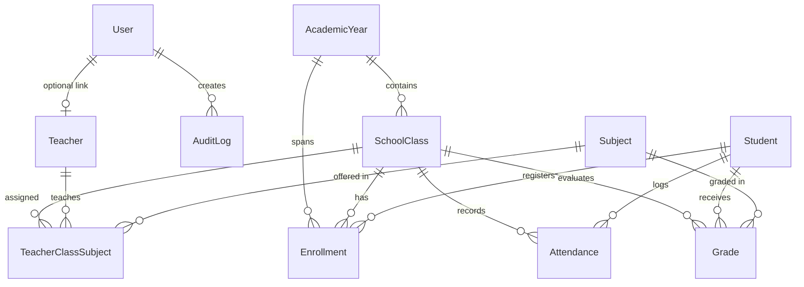

# الوثيقة الشاملة للمشروع: نظام إدارة المدرسة – الإصدار الثاني (School Management System V2)

---

## 1. نبذة عامة عن المشروع (Executive Summary)
نظام **School Management System V2** هو منصة سحابية متكاملة (Full-Stack Web Application) تم تصميمها وتطويرها لإدارة العمليات الأكاديمية والإدارية في المؤسسات التعليمية والمدارس. تم بناء النظام بالاعتماد على أحدث المعايير البرمجية لضمان قابلية التوسع (Scalability) العالية واستيعاب من 200 طالب إلى آلاف الطلاب مع الحفاظ على سرعة الاستجابة وكفاءة الأداء وسلامة البيانات.

---

## 2. مكدس التقنيات المستخدمة (Technology Stack)

### أ. الواجهة الأمامية (Frontend)
- **الإطار الأساسي**: React 19 + Vite 7 (تجميع فائق السرعة وخفة في الأداء).
- **التصميم والأسلوب**: Modern Vanilla CSS Design System بنظام متغيرات (CSS Variables) للألوان، الحواف، الظلال، والتجاوب مع جميع أحجام الشاشات (Desktop & Tablet Friendly).
- **إدارة الحالة**: React Context API (`AuthContext`, `ToastContext`).
- **أيقونات النظام**: SVG Icons مخصصة ومدمجة ذات تصميم احترافي وخفيف الوزن.
- **التواصل مع السيرفر**: Modern Fetch API مع معالجة الـBlobs وتنزيل ملفات Excel ومعالجة الأخطاء بصيغة JSON.

### ب. الواجهة الخلفية (Backend)
- **بيئة التشغيل**: Node.js v24.
- **إطار العمل**: Express.js 5.
- **التحقق من المدخلات**: Zod Validation Schemas على كافة المسارات.
- **المصادقة والتشفير**: JSON Web Tokens (JWT) + Bcryptjs لتشفير كلمات المرور (Salt Rounds = 12).
- **الأمان والحماية**:
  - Helmet لحماية ترويسات الـHTTP.
  - CORS لحصر النطاقات المسموحة.
  - Rate Limiting لمنع هجمات التخمين (Brute-force) على تسجيل الدخول.
  - معالجة مركزية للأخطاء (Centralized Error Handler) لمنع تسريب التفاصيل التقنية للمستخدم.

### ج. قاعدة البيانات (Database & ORM)
- **محرك قاعدة البيانات**: PostgreSQL 16.
- **طبقة الوصول للبيانات (ORM)**: Prisma ORM v6.
- **استراتيجية الفهرسة (Indexes)**: فهارس مركبة وفردية على أرقام الطلاب، أسماء العائلة، أرقام المعلمين، سجلات الحضور، والدرجات.

---

## 3. هيكلية قاعدة البيانات والعلاقات (Database Models & Relations)

### الجداول الأساسية:
1. **`User`**: المستخدمون، البريد، كلمة المرور المشفرة، الدور (`ADMIN`, `STAFF`, `TEACHER`)، حالة الحساب.
2. **`Student`**: رقم الطالب الفريد (`studentNumber`)، الاسم الثلاثي، الجنس، تاريخ الميلاد، هاتف ولي الأمر، العنوان، والحالة الأكاديمية (`ACTIVE`, `INACTIVE`, `GRADUATED`, `WITHDRAWN`).
3. **`Teacher`**: الرقم الوظيفي الفريد (`employeeNo`)، الاسم، التخصص، الهاتف، والبريد الإلكتروني.
4. **`AcademicYear`**: السنوات الدراسية (مثل `2026/2027`)، تاريخ البداية والنهاية، وحالة التفعيل (Active Year).
5. **`SchoolClass`**: الصفوف والشعب (مثل `Grade 7 A`) مرتبطة بالسنة الدراسية.
6. **`Subject`**: المواد والمناهج الدراسية وأكوادها الفريدة (مثل `MATH`, `ENG`, `SCI`).
7. **`TeacherClassSubject`**: جدول ربط المعلم بالصف والشعبة والمادة التي يُدرسها.
8. **`Enrollment`**: تسجيل الطلاب بالصفوف لكل سنة دراسية، مع منع تكرار التسجيل في نفس الصف وحفظ التاريخ الأكاديمي للسنوات السابقة.
9. **`Attendance`**: رصد الحضور اليومي (`PRESENT`, `ABSENT`, `LATE`, `EXCUSED`) مع منع تكرار التسجيل في نفس التاريخ والملاحظات.
10. **`Grade`**: تقييمات الامتحانات والدرجات والنسب المئوية المحسوبة تلقائيًا.
11. **`AuditLog`**: سجل تتبع الحركات والعمليات الإدارية لضمان الأمان والرقابة.

---

## 4. الأدوار والصلاحيات (Role-Based Access Control)

| الدور (Role) | الصلاحيات والمسؤوليات |
| :--- | :--- |
| **ADMIN (المدير العام / الإدارة التنفيذية)** | • **الرقابة والإشراف المؤسسي الشامل**: الاطلاع الكامل على كافة السجلات والتقارير التنفيذية دون التدخل في إدخال بيانات الطلاب اليومية. • **إدارة المستخدمين والأدوار**: إنشاء وتعديل وإعادة ضبط كلمات المرور وتعيين الصلاحيات لحسابات المدراء والموظفين والمعلمين. • **سجل الرقابة والتدقيق الأمني (Audit Logs)**: مراقبة وتتبع تاريخ العمليات الإدارية الحساسة وعناوين الـIP. • **الحوكمة الأكاديمية**: إدارة السنوات والتقويم الدراسي، الصفوف، المناهج، وشؤون المعلمين. |
| **STAFF (موظف شؤون الطلاب والتسجيل)** | • **إدارة وقبول الطلاب**: إضافة الطلاب، استيرادهم من Excel، تعديل السجلات، وتعطيل الحسابات. • **تسكين وتوزيع الفصول (Enrollment Placement)**: توزيع الطلاب على الشعب للسنوات النشطة. • **إدارة الصفوف والمواد والسنوات**: إعداد الفصول والسعات الاستيعابية. • **متابعة الحضور واستخراج التقارير**: رصد ومتابعة الغياب وكشوف الدرجات والتقارير الأكاديمية. |
| **TEACHER (المعلم)** | • **الصفوف والمقررات المسندة**: الاطلاع على شعب ومواد المعلم وقوائم طلابه فقط. • **رصد الحضور اليومي**: تسجيل حضور وغياب طلاب صفوفه في الوقت الفعلي. • **رصد الدرجات**: إدخال وتعديل درجات الامتحانات والواجبات لمواده الدراسية. |

---

## 5. ميزات الأمان المتقدمة (Security Architecture)
1. **تشفير كلمات المرور**: استخدام خوارزمية `bcrypt` بـ 12 Salt Rounds.
2. **جلسات آمنة**: إصدار توكنات `JWT` مشفرة تنتهي صلاحيتها وتُفحص في كل طلب للـAPI.
3. **حماية من حقن SQL**: بفضل الاستعلامات المحمية بالكامل عبر `Prisma Parameterized Queries`.
4. **التحقق الدقيق من البيانات**: منع تمرير أي مدخلات غير مطابقة لأنماط Zod المعتمدة.
5. **سجل التدقيق (Audit Trails)**: توثيق من قام بكل عملية، وقتها، عنوان الـIP، وتفاصيل التغيير.

---

## 6. ميزات تصدير واستيراد Excel
- **استيراد الطلاب**: رفع ملفات `.xlsx` أو `.csv` مع فحص مسبق (Preview Validation) يكتشف فورًا الحقول الناقصة، تكرار رقم الطالب، الأخطاء في التواريخ أو الجنس، مع عرض تقرير بعدد السجلات السليمة والتالفة قبل الإدخال الفعلي.
- **تصدير التقارير**: تصدير مباشر بضغطة زر لقوائم الطلاب، سجلات الحضور، ومصفوفة درجات المواد والمعدلات بصيغة جداول Excel جاهزة للاستخدام والطباعة.

---

## 7. الدعم ثنائي اللغة والبوابات المنفصلة (Bilingual & Dedicated Portals)
- **التحويل الديناميكي للغة (Dynamic Language Switcher)**:
  - دعم كامل للغتين العربية والإنجليزية مع زر تبديل فوري `🌐 العربية / English`.
  - تطبيق اتجاه النصوص والتنسيقات (`dir="rtl"` و `dir="ltr"`) مع خطوط متوافقة (Cairo & Inter).
  - حفظ اللغة المختارة تلقائياً في `localStorage`.
- **روابط البوابات المخصصة لكل دور (Dedicated Role Portals)**:
  - **بوابة المدير**: `http://localhost:5173/?role=admin`
  - **بوابة موظف المدرسة**: `http://localhost:5173/?role=staff`
  - **بوابة المعلم**: `http://localhost:5173/?role=teacher`
  - ميزة **الدخول الفوري بنقرة واحدة (⚡ Instant Access)** لتسهيل الاختبار والتنقل بين الأدوار.

