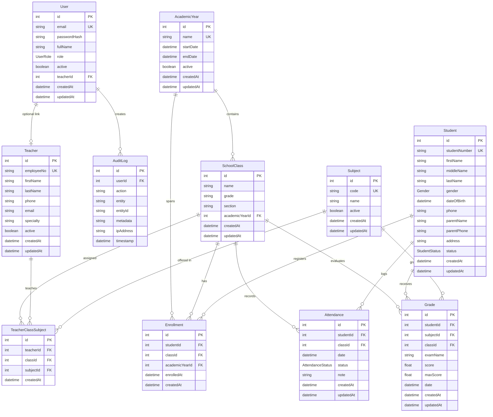

# Database Architecture & Design Document (School Management System V2)

## 1. Overview
The School Management System V2 uses **PostgreSQL 16** with **Prisma ORM**. The schema is designed to scale effortlessly from 200 students to 1,000, 5,000, and 10,000+ students without requiring database redesign.

All queries use indexed columns, foreign key constraints with cascading logic, and server-side pagination.

---

## 2. Entity Relationship Diagram (ERD)

---

## 3. Database Indexes Strategy

| Model | Indexed Fields | Purpose |
| :--- | :--- | :--- |
| `Student` | `studentNumber` (UNIQUE) | High-speed single student lookup |
| `Student` | `[lastName, firstName]` | Compound search across student full names |
| `Student` | `firstName`, `lastName` | Partial string queries and sorting |
| `Student` | `status` | Instant filtering by active/inactive/graduated status |
| `Student` | `parentPhone` | Quick parent search |
| `Teacher` | `employeeNo` (UNIQUE) | Fast teacher code identifier lookup |
| `Teacher` | `[lastName, firstName]` | Alphabetical listing and sorting |
| `Teacher` | `active` | Active faculty filtering |
| `Attendance` | `[studentId, date]` (UNIQUE) | Prevents duplicate daily attendance per student |
| `Attendance` | `date` | Date range query optimization for attendance reports |
| `Attendance` | `classId`, `status` | Class-level daily roll calls |
| `Grade` | `studentId`, `subjectId`, `classId` | Grade matrix and report card aggregations |
| `Enrollment` | `[studentId, classId]` (UNIQUE) | Prevents double enrollment in same class |
| `AuditLog` | `userId`, `action`, `entity`, `timestamp` | Audit trails & security monitoring |

---

## 4. Preservation of Historical Data
When a student moves from one academic year to the next (e.g. Grade 7 in 2025/2026 -> Grade 8 in 2026/2027), prior records in `Enrollment`, `Attendance`, and `Grade` are permanently retained. Slicing by `academicYearId` allows retrieving exact historical student performance at any time.
